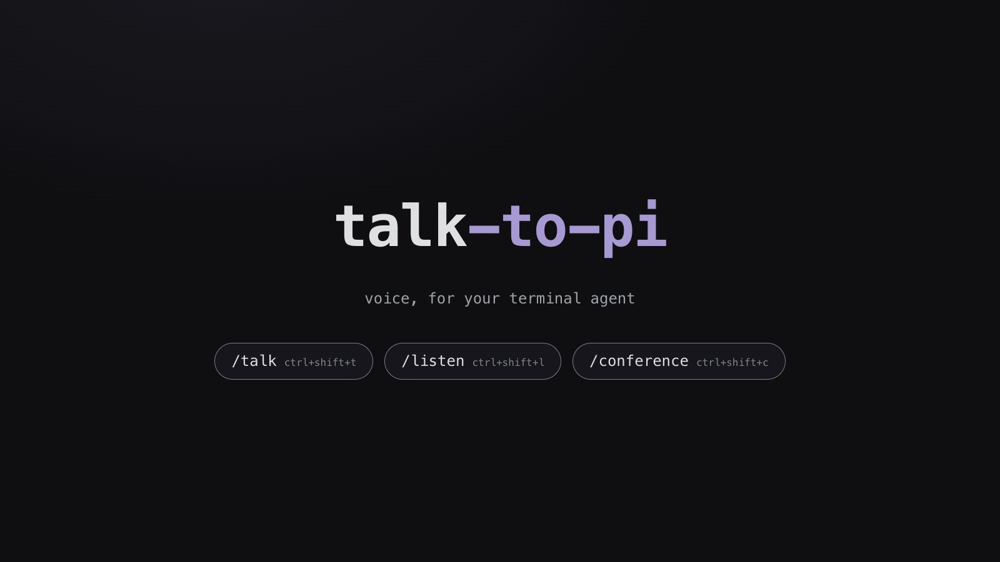

# talk-to-pi

A pi extension that adds a **`/talk`** voice mode: hold **F5** to talk, pi answers out loud.

[](video/talk-to-pi.mp4)

*▶ [83-second explainer](video/talk-to-pi.mp4) — same voice the extension speaks with.*

- **Hold `F5`** → pi records your voice (`sox` → OpenRouter `input_audio` STT).
- **Release** → pi transcribes and auto-submits it as your message.
- **Esc** → stop pi talking and abort the run (or cancel an in-progress recording). Esc never exits a mode.
- pi's answers are **spoken aloud** (OpenRouter → ElevenLabs TTS by default, `say` offline fallback), streamed sentence by sentence.

See [`SPEC.md`](SPEC.md) for the full behaviour contract and [`config.json`](config.json) for tunables.

## Install

```sh
# global (available in every pi session)
ln -sfn "$PWD" ~/.pi/agent/extensions/talk

# or project-only during development
pi --extension ./talk-to-pi
```

Restart pi (or run `/reload`), then type `/talk`.

## Usage

| key | when | action |
|---|---|---|
| **hold `F5`** | idle, talk mode on | start recording |
| **F5** | while pi is speaking | interrupt + start recording (barge-in) |
| `ctrl+shift+t` | any time | toggle `/talk` |
| `ctrl+shift+l` | any time | toggle `/listen` |
| `ctrl+shift+c` | any time | toggle `/conference` |
| `ctrl+shift+o` | any time | open voice, speed & `/say` menu |
| **release** | recording | stop, transcribe, submit |
| **Esc** | recording | cancel recording |
| **Esc** | while pi is working/speaking | stop audio + abort the run |
| **Esc** | idle | does nothing (never exits a mode) |
| `/talk` | any time | toggle talk mode |
| `/say <message>` | any time | send a typed message; pi reads the answer out loud |

**Prefer typing to talking?** `/say <message>` sends the message without push-to-talk — pi
answers in the terminal as usual and reads the reply out loud. It works whether or not talk mode is
on. Two modes (pick in `ctrl+shift+o`, or set `say.mode` in `config.json`):

- **`auto`** (default) — pi speaks the answer the moment it streams.
- **`approval`** — when the answer is ready, pi shows it and asks you to press Enter before speaking (Esc skips).

## Demo video

The 83-second explainer lives in [`video/`](video/talk-to-pi.mp4). Everything is regenerated
from source — no screen recording:

```sh
node video/tts.mjs     # narrate each scene, measure it → video/build/timeline.json
node video/theme.mjs   # pi's real dark theme → video/build/theme.css
node video/build.mjs   # render every frame from the page clock, mux with ffmpeg
```

- [`video/script.md`](video/script.md) — the script and shot list
- [`video/scene.html`](video/scene.html) — animated mockup; `seek(t)` is a pure function of time,
  so frames are captured deterministically and never drift from the narration
- `video/build.mjs` captures frames over CDP at 12 fps and lays the narration on the same offsets

While talk mode is on, **everything stays editable — including Space**. The talk key is read
natively from the keyboard, so it never steals a key from the editor. (It only works while your
terminal app is focused.)

The footer shows the current state: `🎙 talk: idle` · `🎙 listening` · `🎙 transcribing…` ·
`🧠 thinking` · `🔊 speaking`. While waiting (transcribing or thinking), the wave animates so
you can see pi is working from the moment you release the talk key until it starts speaking back.

A soft two-note audio cue (a gentle low→high blip every ~0.6 s) plays during the same wait
window, so you can also **hear** that pi is processing. It stops the instant speech starts or
the mode turns off. Disable it with `audio.processingCue: false`.

The footer also shows `🎧 headset: on` / `🎧 headset: off` while talk or conference mode is on,
based on whether `audio.headsetDevice` is actually present in CoreAudio (a Bluetooth headset that
is switched off disappears from the device list). You get a notification when it connects or drops
mid-session:

```json
"audio": { "headsetDevice": "OpenSwim Pro by Shokz" }
```

Set it to `""` to disable the watch entirely (no probing, no footer item).

In conference mode the cue rides pi's voice path — `sox` into the room Multi-Output
(`Pi Talks (headset)`, your headphones + BlackHole 2ch) — as a continuous loop, since the
Multi-Output needs a beat to start flowing and would otherwise swallow the short notes.
Meeting participants hear the blip too, while the `/listen` tap stays clean.
Set `conference.muteBusyCue: true` to silence it in calls entirely.

## Listen mode

`/listen` records the **microphone** continuously and transcribes it in ~5 s chunks via
OpenRouter's `/audio/transcriptions` endpoint (default `deepgram/nova-3`), skipping silence.
The running transcript is appended to a Markdown file and made available to pi:

- the **most recent part** is injected into the system prompt on every turn, and
- the **`listen_transcript` tool** lets pi search the whole transcript for older content.

While listening, pi's own spoken answers are appended too, labeled `pi:` — pi is the only
identified speaker (everyone else is unlabeled).

`/listen` (or `ctrl+shift+l`) toggles recording; the footer shows `📝 listen: recording · N segments`.
The most recent transcript lines stream in a widget above the editor.

When you **stop** `/listen`, pi offers to save a finalized Markdown file: an LLM-written
summary at the top, and a filename `date_title.md` — e.g. `2026-10-18_q3-launch-plan.md` — where the
title is a short summary of the conversation. Declining keeps the raw transcript file. Output dir: `~/.pi/listen/`.

The discussion **stays in context after you stop**: pi leaves a durable note in the conversation
containing the summary and the file path, so later questions about “the meeting” still work. The
live widget disappears when recording stops, but the full transcript remains searchable through the
`listen_transcript` tool — it reads the saved Markdown once the session has ended.

`listen.contextMode` controls the trade-off:

| value | what stays in context | cost |
|---|---|---|
| `summary` (default) | LLM recap + file path | a few hundred tokens |
| `full` | the entire transcript (capped at 20k chars) | thousands of tokens, every turn |
| `none` | nothing (file only, still searchable) | zero |

## Conference mode

`/conference` (or `ctrl+shift+c`) lets pi join your Zoom/Meet call.

While it's on, the extension also flips the **system default input/output** to
`BlackHole 2ch` / a `Pi Listens` Multi-Output. When you toggle off, the output goes straight back
to a **direct device** (`Shokz` if connected, else `MacBook Pro Speakers`) — not a Multi-Output —
and the input goes back to the **built-in mic** (`MacBook Pro Microphone`), never the headset mic.
So a call app set to "same as system" follows automatically (no per-app settings).

Routing follows two dimensions: **local/remote** (= `/conference`) and **headset on/off**
(detected automatically from `audio.headsetDevice`, re-routed live if it changes mid-call):

| | headset on | headset off |
|---|---|---|
| **local** | mic built-in → speaker Shokz | mic built-in → speaker MacBook Pro |
| **remote** | in BlackHole 2ch → out `Pi Listens (headset)` | in BlackHole 2ch → out `Pi Listens (speaker)` |

- **pi speaks → you and the room.** pi's TTS is played into the active Multi-Output (`voiceDevice`
  = your playback device + BlackHole 2ch), so you hear it and the room hears it through Zoom's
  microphone.
- **room hears you too.** your microphone is relayed into BlackHole (since you never talk at
  the same time as pi, no mixer is needed).
- **`/listen` hears everyone.** while conference mode is on, `/listen` also transcribes the
  remote meeting audio (tapped from BlackHole 16ch) alongside your mic.
- the busy blip plays into the room Multi-Output like pi's voice, so participants hear it too
  (`conference.muteBusyCue: true` silences it).

**Balancing your voice vs pi's.** The two paths into the room have different levels: pi's TTS
arrives from ElevenLabs already normalized (near 0 dBFS), while your mic arrives at whatever the
room and mic gain give it — so pi usually sounds louder. Set `conference.micGain` (e.g. `2.0`) to
bring yourself up, or `conference.ttsGain` (e.g. `0.7`) to bring pi down. Both are linear gains
(`sox ... vol`). If boosting the mic past ~2× starts to sound harsh, your mic was already near full
scale — lower `ttsGain` instead. Gains are read when conference mode starts, so toggle it off/on
after editing `config.json`.

**One-time setup:**

```sh
brew install --cask blackhole-2ch blackhole-16ch   # audio driver → log out/in
```

Then in **Audio MIDI Setup** create **four** Multi-Output devices — one pair per headset column:

| device | = |
|---|---|
| `Pi Talks (headset)` | Shokz + BlackHole 2ch |
| `Pi Listens (headset)` | Shokz + BlackHole 16ch |
| `Pi Talks (speaker)` | MacBook Pro Speakers + BlackHole 2ch |
| `Pi Listens (speaker)` | MacBook Pro Speakers + BlackHole 16ch |

In the call app: **Microphone = BlackHole 2ch**, **Speaker = same as system** (or whichever
`Pi Listens` you want) — leaving it on "same as system" lets `/conference` switch it, headset
column included, automatically.

> The built-in column echoes: the meeting plays out of your MacBook speakers next to the mic being
> relayed into the room. Prefer the headset; with built-in, lean on the call app's echo cancellation.

## Requirements

- macOS (uses `say`, `afplay`, `sox`, and small compiled CoreAudio helpers)
- `sox` (`brew install sox`) for mic recording and device routing
- Xcode command-line tools (`clang`) to compile `native/keywatcher.m` and `native/audio-default.m` on first use
- `BlackHole 2ch` + `BlackHole 16ch` for conference mode (`brew install --cask blackhole-2ch blackhole-16ch`)
- An OpenRouter OAuth login in `~/.pi/agent/auth.json` (STT, cloud TTS, transcript summaries)

## Voices

The default TTS voice is **rachel** at **1×** (ElevenLabs Flash v2.5, through OpenRouter — no extra key).
Available curated voices, set via `tts.voice` in `config.json`:

`aria` · `rachel` · `sarah` · `adam` · `antoni` · `george` — or any raw ElevenLabs voice id.

To audition a cloud voice, generate a clip and listen:

```sh
curl -s https://openrouter.ai/api/v1/audio/speech \
  -H "Authorization: Bearer $(jq -r .openrouter.access ~/.pi/agent/auth.json)" \
  -H "Content-Type: application/json" \
  -d '{"model":"elevenlabs/eleven-flash-v2.5","input":"Alright, I will refactor the login handler.","voice":"9BWtsMINqrJLrRacOk9x","response_format":"mp3"}' \
  -o /tmp/voice.mp3 && afplay /tmp/voice.mp3
```

(`21m00Tcm4TlvDq8ikWAM` = rachel; the other curated ids map is in `src/speaker.ts`.)

**Change voice, speed, or `/say` mode at any time** with `ctrl+shift+o` (or `/voice`): a small menu
lets you pick the voice, a speed from 0.8× to 1.2×, and the `/say` reply mode (`auto` vs
`approval`). Voice and speed take effect on pi's next sentence; the `/say` mode is saved to
`config.json`.

Swap `tts.provider` to `"say"` for a fully offline voice, with `tts.sayVoice: "auto"`
picking the best installed macOS English voice.

## Configuration

Edit `config.json`:

| key | default | meaning |
|---|---|---|
| `stt.model` | `mistralai/voxtral-small-24b-2507` | OpenRouter model with `input_audio` support |
| `stt.sampleRate` / `channels` / `bits` | `16000` / `1` / `16` | sox capture format |
| `tts.provider` | `openrouter` | `openrouter` (cloud) or `say` (offline) |
| `tts.model` | `elevenlabs/eleven-flash-v2.5` | OpenRouter TTS model |
| `tts.voice` | `rachel` | voice name or ElevenLabs voice id (cloud) |
| `tts.speed` | `1.0` | default speed multiplier (0.8–1.2) |
| `tts.format` | `mp3` | output format for cloud TTS |
| `tts.command` | `say` | TTS binary used by the `say` provider |
| `tts.sayVoice` | `auto` | voice name for the `say` provider |
| `input.key` / `keyCode` | `f5` / `96` | talk key (held to talk) |
| `input.talkTerminalApps` | (terminals) | frontmost-app bundle ids where the talk key counts |
| `input.listenShortcut` | `ctrl+shift+l` | toggle `/listen` |
| `input.talkShortcut` | `ctrl+shift+t` | toggle `/talk` |
| `input.conferenceShortcut` | `ctrl+shift+c` | toggle `/conference` |
| `input.voiceShortcut` | `ctrl+shift+o` | open voice & speed menu |
| `input.micDevice` | `MacBook Pro Microphone` | the mic always used for talk + `/listen` (never the headset mic) |
| `input.pollMs` | `25` | native release-poll interval |
| `input.repeatSilenceMs` | `150` | autorepeat-fallback release threshold |
| `input.debounceMs` | `250` | ignore a press this soon after release |
| `input.minRecordingMs` | `400` | recordings shorter than this are discarded |
| `promptNudge` | `true` | append a voice-style instruction to the system prompt |
| `audio.processingCue` | `true` | audible blip while waiting (transcribing/thinking) |
| `audio.volume` | `0.4` | cue volume (0–1) |
| `audio.headsetDevice` | `` | device watched for the connected/off indicator (empty = off) |
| `audio.localSpeaker` | `` | built-in speakers for local playback when the headset is off |

| `audio.intervalMs` | `650` | pause between cue notes |
| `listen.model` | `deepgram/nova-3` | OpenRouter STT model |
| `listen.chunkSeconds` | `5` | transcription chunk size |
| `listen.skipSilence` / `silenceThreshold` | `true` / `0.005` | skip silent chunks |
| `listen.outputDir` | `~/.pi/listen` | transcript storage directory |
| `conference.headset.voiceDevice` | `Pi Talks (headset)` | pi → you(headset) + room |
| `conference.headset.systemOutputDevice` | `Pi Listens (headset)` | call → you(headset) + tap |
| `conference.builtin.voiceDevice` | `Pi Talks (speaker)` | pi → you(built-in) + room |
| `conference.builtin.systemOutputDevice` | `Pi Listens (speaker)` | call → you(built-in) + tap |
| `conference.roomDevice` | `BlackHole 2ch` | the virtual device Zoom uses as its microphone |
| `conference.remoteTapDevice` | `BlackHole 16ch` | remote meeting audio tapped into `/listen` |
| `conference.relayMic` / `remoteTap` | `true` | room relays toggles |
| `conference.micGain` | `1.0` | gain on your relayed mic (raise if the room hears you quieter than pi) |
| `conference.ttsGain` | `1.0` | gain on pi's voice in the room (lower it to balance) |
| `conference.muteBusyCue` | `false` | silence the cue in calls (it normally plays into the room) |
| `conference.systemInputDevice` | `BlackHole 2ch` | system default input while conference is on |
| `conference.switchSystemDevices` | `true` | auto-switch system devices on enter; on exit output → direct headset/speaker, input → built-in mic |
| `listen.contextWindowChars` | `6000` | recent transcript injected into the prompt |
| `listen.widgetLines` | `8` | transcript lines shown above the editor |
| `listen.summaryModel` | `deepseek/deepseek-chat` | model that writes the save-time summary + title |
| `listen.contextMode` | `summary` | what stays in context on stop: `summary`, `full`, `none` |
| `say.mode` | `auto` | `/say` behavior: `auto` (speak as it streams) or `approval` (show + wait for Enter) |

## How the talk key is detected

The talk key (F5 by default) is read directly from the keyboard, so the terminal never sees it at
all. talk-to-pi polls the macOS keyboard state (`CGEventSourceKeyState`) via `native/keywatcher.m`
(compiled on first use) for both **press and release**, and only counts the key while one of
`input.talkTerminalApps` is the frontmost app. That is what lets Space stay free for typing.

## Costs

- **STT** (`voxtral-small`): ~$0.0006 per ~6 s utterance.
- **TTS default** (`elevenlabs/eleven-flash-v2.5`): ~$0.02 per 1k characters — roughly a
  cent for a handful of spoken sentences. Set `tts.provider: "say"` for zero cost.